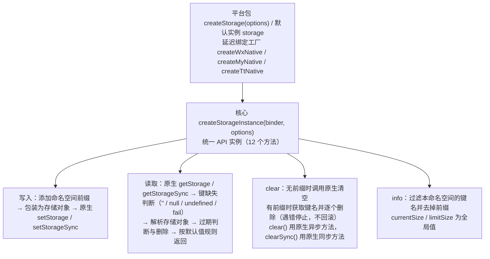

# @mini-dev/storage

微信 / 支付宝 / 抖音小程序通用的本地存储库。一套 API 在三端行为一致，并在原生存储之上提供命名空间、TTL 过期、键缺失默认值和类型化键表。

```javascript
const { createStorage } = require('@mini-dev/storage-wx');

const userStore = createStorage({ namespace: 'user', defaultTtl: 7 * 24 * 3600 * 1000 });

userStore.setSync('token', 'abc');
userStore.getSync('token', 'guest');   // 'abc'；键不存在或已过期时返回 'guest'
```

> 本页是整个库的完整文档。使用时按平台安装平台包（`@mini-dev/storage-wx` / `-my` / `-tt`），本包 `@mini-dev/storage` 会作为依赖自动安装，不需要单独安装。

## 1. 为什么用

以微信为例，用原生 API 实现「带命名空间、7 天过期、读不到时给默认值」：

```javascript
// 原生写法
const PREFIX = 'user/';
const TTL = 7 * 24 * 3600 * 1000;

wx.setStorageSync(PREFIX + 'token', { value: 'abc', expireAt: Date.now() + TTL });

function readToken() {
    const raw = wx.getStorageSync(PREFIX + 'token');
    if (raw === '') return 'guest';                  // 键不存在时微信返回空串
    if (raw.expireAt && raw.expireAt < Date.now()) { // 手动判断过期
        wx.removeStorageSync(PREFIX + 'token');
        return 'guest';
    }
    return raw.value;
}
```

```javascript
// 使用本库
const userStore = createStorage({ namespace: 'user', defaultTtl: 7 * 24 * 3600 * 1000 });

userStore.setSync('token', 'abc');
const token = userStore.getSync('token', 'guest');
```

本库替你处理的事情：

- **键缺失判断**：三端原生 API 在键不存在时的返回形式各不相同（空串、`null`、走 `fail` 回调），本库统一为「键缺失」，按默认值规则返回（见 [§6](#6-键缺失时的返回值)）。三端差异的细节见 [§7](#7-三端差异的处理)。
- **TTL 过期**：写入时记录过期时间，读取时自动判断并删除过期数据。
- **命名空间**：不同模块使用各自的实例，键名互不冲突，`clear()` 只清理本模块的数据。
- **Promise 化**：异步方法返回 Promise，不再需要 `success` / `fail` 回调。
- **类型检查**：TypeScript 中可以声明键名与值类型的对应关系（见 [§10](#10-类型化键表)）。

## 2. 安装

按目标平台安装一个平台包：

| 平台 | 安装命令 | 模块语法 | 构建步骤 |
| --- | --- | --- | --- |
| 微信 | `npm i @mini-dev/storage-wx` | `require` | 微信开发者工具：**工具 → 构建 npm** |
| 支付宝 | `npm i @mini-dev/storage-my` | `import` 或 `require` | 按支付宝小程序 IDE 的 npm 构建流程 |
| 抖音 | `npm i @mini-dev/storage-tt` | `require` | 按抖音开发者工具的 npm 构建流程 |

- 各平台包的 `miniprogram` 字段指向 CommonJS 产物，小程序「构建 npm」会把平台包和本包一起构建到 `miniprogram_npm`。
- 支付宝小程序的 npm 构建支持 ESM 转译，可以用 `import`；微信和抖音的示例都使用 `require`。
- 平台包只在对应平台使用：例如 `@mini-dev/storage-wx` 只会调用 `wx` 全局对象，不检测运行平台。

> 为什么拆成多个平台包：部分小程序平台的「构建 npm」不支持 `package.json` 的 `exports` 子路径，`require('@mini-dev/storage/wx')` 这种写法会失败。每个平台一个独立包，可以在所有平台正常构建。

## 3. 快速开始

```javascript
// pages/index/index.js（微信；支付宝 / 抖音只需替换包名）
const { createStorage, storage } = require('@mini-dev/storage-wx');

// 模块级创建实例，配置在创建时确定，之后不可修改
const userStore = createStorage({
    namespace: 'user',                    // 键前缀，物理键为 user/<key>
    defaultTtl: 7 * 24 * 3600 * 1000      // 默认 7 天过期（毫秒）
});

Page({
    async onLoad() {
        // 写入
        await userStore.set('profile', { name: 'A' });
        await userStore.set('token', 'abc', { ttl: 3600 * 1000 });   // 这个键 1 小时过期

        // 读取：命中时直接返回原值
        const profile = await userStore.get('profile');               // { name: 'A' }

        // 读取并指定默认值：键不存在或已过期时返回默认值
        const theme = userStore.getSync('theme', 'light');            // 'light'

        // 零配置的默认实例：无前缀、无过期时间
        storage.setSync('lastVisit', Date.now());
    }
});
```

## 4. 配置项

`createStorage(options)` 的 `options`：

| 字段 | 类型 | 默认值 | 说明 |
| --- | --- | --- | --- |
| `namespace` | `string` | 无前缀 | 键前缀。设置为 `'user'` 时，键 `token` 的物理键为 `user/token` |
| `defaultTtl` | `number` | 永不过期 | 实例默认过期时间（毫秒），大于 0 时生效 |
| `recordAt` | `boolean` | `false` | 是否在存储数据中记录写入时间（`_at` 字段，见 [§9](#9-物理存储格式与原生-api-互操作)） |
| `keyMissing` | `(key) => unknown` | 无 | 键缺失时调用，返回值作为 `get` 的结果，也可以在函数内抛错（见 [§6](#6-键缺失时的返回值)） |

- 配置在创建时确定，之后不能修改。需要不同配置时，创建新的实例。
- 平台包另外导出一个零配置的默认实例 `storage`，等价于 `createStorage()`。

## 5. API 列表

每个操作都有异步和同步两个版本：不带后缀的方法返回 Promise，`Sync` 后缀的方法直接返回结果。

| 操作 | 异步 | 同步 | 返回值 |
| --- | --- | --- | --- |
| 写入 | `set(key, data, options?)` | `setSync(key, data, options?)` | 无 |
| 读取 | `get(key, defaultValue?)` | `getSync(key, defaultValue?)` | 存储的原值；键缺失时见 [§6](#6-键缺失时的返回值) |
| 判断是否存在 | `has(key)` | `hasSync(key)` | `boolean` |
| 删除 | `remove(key)` | `removeSync(key)` | 无；键不存在不报错 |
| 清空 | `clear()` | `clearSync()` | 无；只清空本实例命名空间下的键（见 [§8](#8-ttl-与-clear--info-的作用范围)） |
| 存储信息 | `info()` | `infoSync()` | `{ keys, currentSize, limitSize }`（见 [§8](#8-ttl-与-clear--info-的作用范围)） |

- `set` 的 `options` 目前只有 `ttl` 一个字段：单位毫秒，覆盖实例的 `defaultTtl`；传 `0` 表示这个键永不过期；不传则使用 `defaultTtl`。
- `get` 命中时返回存储的原值本身，不是原生 API 的 `{ data }` 结构。
- 错误处理：异步方法失败时 reject 原生错误对象，同步方法直接抛出原生错误对象，本库不做包装。写入超出配额是最常见的错误。

## 6. 键缺失时的返回值

「键缺失」指键不存在，或者键已经过期被删除。此时 `get` / `getSync` 按以下优先级决定返回值：

1. 调用时传入的 `defaultValue`
2. 实例配置的 `keyMissing(key)` 函数的返回值
3. `undefined`

```javascript
// 1. 调用时传入默认值，优先级最高
store.getSync('nope', '默认值');                 // '默认值'

// 2. 实例级 keyMissing 函数，适合整个模块统一的默认值
const defaults = { theme: 'light', fontSize: 14 };
const settings = createStorage({
    namespace: 'settings',
    keyMissing: (key) => defaults[key]
});
settings.getSync('theme');                       // 'light'

// 3. 都没有时返回 undefined，可以配合 ?? 使用
store.getSync('nope');                           // undefined
store.getSync('nope') ?? 'fallback';             // 'fallback'
```

- `keyMissing` 函数内抛出的错误会原样传给调用方：同步方法直接抛出，异步方法 reject。可以用它表达「这个键必须存在」的约束。
- `has` / `hasSync` 只判断键是否存在且未过期，不使用默认值。
- 传入 `defaultValue` 时，TypeScript 返回类型不包含 `undefined`，调用方不需要判空（见 [§10](#10-类型化键表)）。

## 7. 三端差异的处理

以下原生 API 的平台差异由本库内部处理，调用方代码在三端完全一致：

| 场景 | 原生行为 | 本库行为 |
| --- | --- | --- |
| 同步读取不存在的键 | 微信 / 抖音返回 `''`，支付宝返回 `null` | 统一为键缺失（[§6](#6-键缺失时的返回值)） |
| 异步读取不存在的键 | 微信 / 抖音走 `fail` 回调，支付宝走 `success` 且 `data` 为 `null` | 统一为键缺失 |
| 键缺失时的错误信息 | 抖音的错误信息末尾带键名 | 不返回错误信息 |
| 用原生 API 存入 `''` 或 `null` | 原生无法区分「存了空值」和「键不存在」 | 读取时视为键缺失 |

- 异步 `get` 的原生 `fail` 一律视为键缺失：原生 `getStorage` 的失败只会是键不存在，读取不会触发配额错误。
- 写入、删除、清空、读取存储信息时的原生错误都是真实错误，按 [§5](#5-api-列表) 的规则原样抛出。
- 各平台的配额限制和其他平台特有问题，见对应平台包文档：[微信](https://github.com/xesam/minidev-storage/tree/main/packages/wx#readme)、[支付宝](https://github.com/xesam/minidev-storage/tree/main/packages/my#readme)、[抖音](https://github.com/xesam/minidev-storage/tree/main/packages/tt#readme)。

## 8. TTL 与 clear / info 的作用范围

### 8.1 TTL

- 过期时间在写入时计算：`set` 传了 `ttl` 用 `ttl`，否则用实例的 `defaultTtl`；两者都没有或为 `0` 时永不过期。
- 读取（`get` / `has` 系列）时发现已过期，返回键缺失，并删除这个键。
- 过期数据只在被读取时删除，没有后台清理（见 [§11](#11-已知边界)）。

### 8.2 clear

- 设置了 `namespace` 的实例：只删除本命名空间下的键。实现方式是先获取全部键名，再逐个删除。
- 未设置 `namespace` 的实例（包括默认实例 `storage`）：直接调用原生的清空方法，删除全部数据。
- 逐个删除时，遇到错误立即停止并抛出，已删除的键不会恢复。
- `clear()` 使用原生异步方法，删除过程不会阻塞页面；`clearSync()` 使用原生同步方法，键很多时会阻塞 JS 线程。

### 8.3 info

- `keys`：本实例命名空间下的键名列表，已去掉前缀。例如物理键 `user/token` 返回为 `token`。
- `currentSize` / `limitSize`：整个小程序存储的当前用量和上限（单位 KB）。原生 API 不提供单个键的大小，所以这两个值不区分命名空间。

## 9. 物理存储格式与原生 API 互操作

### 9.1 存储格式

本库写入的数据会包装成一个对象再交给原生 API 存储：

```jsonc
{
    "_v": 1,                     // 格式版本，始终存在
    "_val": { "name": "A" },     // 实际存储的值，始终存在
    "_at": 1762011975000,        // 写入时间，recordAt: true 时存在
    "_exp": 1762616775000        // 过期时间，设置了 TTL 时存在
}
```

数据由原生 API 序列化，本库不做额外的字符串转换。

### 9.2 与原生 API 混用

| 写入方 | 读取方 | 结果 |
| --- | --- | --- |
| 本库 | 本库 | 返回原值，已过期时为键缺失 |
| 原生 API | 本库 | 原样返回，对象返回对象，字符串返回字符串 |
| 本库 | 原生 API | 读到 §9.1 的包装对象，而不是原值 |

本库判断一个值是否是自己写入的包装对象的规则是：值为对象，且 `_v` 字段为数字，且存在 `_val` 字段。原生写入的数据如果恰好满足这个条件，会被当作包装对象解析。

### 9.3 从原生 API 迁移

- **存量数据可以直接读取**：原生 API 写入的数据，用本库 `get` 读取时原样返回，不需要迁移脚本。
- **注意键名前缀**：存量数据没有命名空间前缀。要读取它们，使用未设置 `namespace` 的实例（例如默认实例 `storage`）；或者读出后用新实例重新写入。
- **新写入的数据原生 API 读不到原值**：迁移期间如果还有代码用原生 API 读取同一个键，会读到包装对象。建议同一个键的读写全部切换到本库。
- **微信加密存储不支持**：使用了 `encrypt: true` 的键请继续使用原生 API（见 [§11](#11-已知边界)）。

## 10. 类型化键表

TypeScript 中，可以用泛型参数声明键名和值类型：

```typescript
import { createStorage } from '@mini-dev/storage-wx';

interface UserSchema {
    profile: { name: string };
    token: string;
}

const store = createStorage<UserSchema>({ namespace: 'user' });

store.getSync('profile');            // 类型：{ name: string } | undefined
store.getSync('token', 'guest');     // 类型：string（传入默认值后不包含 undefined）
store.setSync('token', 123);         // 编译错误：token 的值应为 string
store.getSync('unknown');            // 编译错误：键名不在 UserSchema 中
```

- 不传泛型参数时，键名为任意字符串，值类型为 `unknown`。
- `UserSchema` 用普通的 `interface` 声明即可，不需要索引签名。

## 11. 已知边界

- **微信 `encrypt` 参数不可用**：本库不透传原生参数。微信要求加密数据的写入和读取都声明 `encrypt: true`，本库两侧都不支持，因此无法读写加密的键。需要加密的键请全部使用原生 API 读写，不要和本库混用同一个键。详见 [`@mini-dev/storage-wx`](https://github.com/xesam/minidev-storage/tree/main/packages/wx#readme)「本端注意点」。
- **配额由原生限制**：微信 / 抖音单个键 1MB，支付宝单个键 200KB，总量以各平台官方文档为准。超出配额时，原生错误原样抛出。
- **过期数据只在读取时删除**：过期的键只有在被 `get` / `has` 读到时才会删除，从不读取的过期键会一直占用存储空间。对配额敏感的场景，可以定期遍历 `info().keys`，对每个键调用一次 `get()` 触发清理。
- **命名空间会互相包含**：前缀是字符串拼接，`user` 和 `user/vip` 两个实例中，`user` 实例的 `clear()` 会同时删除 `user/vip` 下的键。本库无法检测这种关系，请避免使用有包含关系的命名空间。
- **读取不会报错**：`get` / `getSync` 的原生失败一律视为键缺失。如果将来某个平台在读取时引入键缺失以外的错误，本库仍会返回键缺失。
- **过期删除失败时不报错**：读取时删除过期键失败，不影响返回键缺失的结果，也不会抛错；下次读取时会再次尝试删除。
- **大对象建议用异步写入**：`setSync` 在调用时同步序列化数据，数据量大时会阻塞 JS 线程。
- **命名空间分隔符固定为 `/`**。

## 12. 自定义平台绑定

本节面向需要接入其他宿主环境（新的小程序平台、存储模拟、测试替身）的用户。普通使用者不需要阅读。

### 12.1 内部结构



- **binder 只负责提供原生方法**：`StorageBinder` 只有一个字段 `native: () => StorageNative`。三端差异都在核心的读取流程中处理，平台包只负责把平台全局对象的存储方法映射到 `StorageNative`。
- **延迟绑定**：`native` 工厂只在第一次存储操作时调用。加载模块（包括创建默认实例）不会访问平台全局对象，所以 `import` 不会报错。平台全局对象不存在时，第一次存储操作会直接抛错，本库不做兼容处理。
- **读取失败的处理**：异步 `getStorage` 的 `fail` 一律视为键缺失；`set` / `remove` / `clear` / `info` 的 `fail` 是真实错误，原样抛出。

### 12.2 使用 `createStorageInstance`

`createStorageInstance(binder, options)` 接收一个 binder，`binder.native()` 返回 `StorageNative`，它与原生存储方法一一对应，共 10 个方法：

```typescript
import { createStorageInstance } from '@mini-dev/storage';
import type { CreateStorageOptions, StorageInstance, StorageNative } from '@mini-dev/storage';

declare const host: any; // 目标宿主的存储全局对象

function createHostNative(): StorageNative {
    return {
        setStorage: (o) => host.setStorage(o),
        setStorageSync: (key, data) => host.setStorageSync(key, data),
        getStorage: (o) => host.getStorage(o),
        getStorageSync: (key) => host.getStorageSync(key),
        removeStorage: (o) => host.removeStorage(o),
        removeStorageSync: (key) => host.removeStorageSync(key),
        clearStorage: (o) => host.clearStorage(o),
        clearStorageSync: () => host.clearStorageSync(),
        getStorageInfo: (o) => host.getStorageInfo(o),
        getStorageInfoSync: () => host.getStorageInfoSync()
    };
}

export function createStorage<Schema extends object>(options: CreateStorageOptions<Schema> = {}): StorageInstance<Schema> {
    return createStorageInstance<Schema>({ native: createHostNative }, options);
}
```

- 自定义绑定也应保持延迟绑定：不要在模块加载时访问宿主全局对象。
- 宿主的键缺失表现只要属于以下形式之一，就会被正确识别：同步读取返回 `''` 或 `null`，异步读取走 `fail`，或走 `success` 且 `data` 为 `null`。
- `CreateStorageOptions`、`SetOptions`、`StorageInfo`、`StorageInstance`、`StorageNative` 等类型都由本包导出，各平台包也会重新导出。

## 13. 构建产物形态

- 每个包都输出 CommonJS 和 ESM 两种格式：`dist/cjs` 和 `dist/esm`，各自带 `.d.ts` 类型文件，语法目标为 ES2015。
- `miniprogram` 字段指向 `dist/cjs/index.js`，供小程序「构建 npm」使用。

## License

MIT
